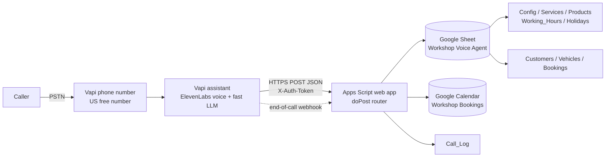

# Workshop Voice Agent

An end-to-end AI phone receptionist for a car mechanic workshop. Customers call a
phone number, a voice agent answers, quotes services from a Google Sheet, and books
servicing into Google Calendar. No code changes are required for the owner to change
prices, hours, services, products or holidays.

## Architecture

Everything the agent says about the business is read live from the Sheet. The agent
never invents prices, hours or availability.

## Repository map

| Path | What it is |
|---|---|
| [docs/architecture.md](docs/architecture.md) | Components, data flow, decision rationale |
| [docs/setup-guide.md](docs/setup-guide.md) | Replicate for a NEW workshop, start to finish |
| [docs/owner-guide.md](docs/owner-guide.md) | Non-technical guide for the mechanic |
| [docs/call-flow.md](docs/call-flow.md) | Conversation design, edge cases, escalation |
| [docs/decisions.md](docs/decisions.md) | Design decision log (incl. defaults chosen) |
| [docs/testing.md](docs/testing.md) | Test plan and latest results |
| [docs/limitations-and-next-steps.md](docs/limitations-and-next-steps.md) | Known limits, roadmap |
| [sheet/schema.md](sheet/schema.md) | Every tab, column, type, validation rule |
| [sheet/create_sheet.gs](sheet/create_sheet.gs) | Builds the whole spreadsheet from scratch |
| [apps-script/DEPLOY.md](apps-script/DEPLOY.md) | Deploying the web app with clasp |
| [vapi/system-prompt.md](vapi/system-prompt.md) | The assistant system prompt |
| [vapi/assistant.json](vapi/assistant.json) | Sanitised exported assistant config |
| [elevenlabs/voice-settings.json](elevenlabs/voice-settings.json) | Voice choice and tuning |
| [CHANGELOG.md](CHANGELOG.md) | Phase-by-phase history |

## Quick start (summary)

1. `cp .env.example .env` and fill in the values.
2. Run `sheet/create_sheet.gs` from the Apps Script editor bound to a new spreadsheet
   (or follow [sheet/schema.md](sheet/schema.md) manually). Put the spreadsheet ID in
   `Config.sheet_id`-adjacent env var.
3. Create the `Workshop Bookings` calendar and paste its ID into `Config.calendar_id`.
4. `clasp push` the Apps Script project, deploy as web app (*Execute as me*,
   *Anyone*), set the `SHARED_TOKEN` script property, copy the `/exec` URL.
5. `node vapi/create-assistant.js` to create the assistant and attach the phone number.
6. Run `tests/api-tests.js` against the web app URL.

## Prerequisites

- A Google account with Sheets + Calendar (and permission to deploy Apps Script).
- Node.js 18+ and `@google/clasp` (`npm i -g @google/clasp`).
- A Vapi account (phone number + API key).
- An ElevenLabs account (voice + API key).
- `git`.

## Configuration principle

Nothing business-specific is hardcoded. Workshop name, phone, address, timezone,
currency, GST, opening hours, services, add-ons, lead times, bay count and the calendar
ID all live in the **Config**, **Working_Hours**, **Holidays_Closures**, **Services**
and **Products_Addons** tabs. Code reads them at call time.

## Status

| Phase | Scope | State |
|---|---|---|
| 0 | Repository skeleton + docs | done |
| 1 | Google Sheet | pending |
| 2 | Google Calendar + availability | pending |
| 3 | Apps Script API | pending |
| 4 | ElevenLabs voice | pending |
| 5 | Vapi assistant | pending |
| 6 | Testing | pending |
| 7 | Replicability audit | pending |
